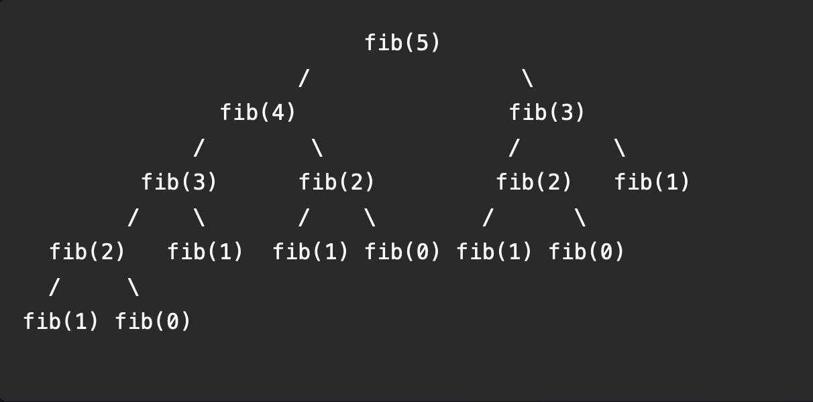

# Fibonacci

Without Memoization, the recursive tree will have to calculate for N mulitple times.



## Reading the Recursive Tree

The image shows the call tree for `fib(5)` using the naive recursive formula. Every node is one function call, and every call splits into two smaller calls:

```
fib(n) = fib(n-1) + fib(n-2)      left child = n-1, right child = n-2
```

The branches stop at the **base cases**, `fib(1) = 1` and `fib(0) = 0`. These are the leaves at the bottom of the tree because they return a value without making any more calls.

### Winding in, winding out

The calls go down the tree first (winding in), and the values are added together on the way back up (winding out). The left side is always fully resolved before the right side starts:

```
fib(2) = fib(1) + fib(0) = 1 + 0 = 1
fib(3) = fib(2) + fib(1) = 1 + 1 = 2
fib(4) = fib(3) + fib(2) = 2 + 1 = 3
fib(5) = fib(4) + fib(3) = 3 + 2 = 5
```

Every value is built from the base cases. `fib(5) = 5` because five `fib(1)` leaves each contribute 1, and the `fib(0)` leaves contribute nothing.

### The problem: repeated work

Count how often each call appears in the tree:

| Call | Times computed |
|---|---|
| fib(5) | 1 |
| fib(4) | 1 |
| fib(3) | **2** |
| fib(2) | **3** |
| fib(1) | **5** |
| fib(0) | **3** |

That is 15 calls to compute 6 distinct values. The entire right subtree `fib(3)` repeats work the left side already did. The tree roughly doubles at every level, so naive recursion is **O(2ⁿ)**. `fib(40)` would take hundreds of millions of calls.

### The fix: memoization

[Program.cs](Program.cs) stores each result in a `Dictionary` the first time it is computed and checks the dictionary before doing any work. On the same tree:

1. The left edge runs once: `fib(5) → fib(4) → fib(3) → fib(2) → fib(1), fib(0)`, storing each result as it winds out.
2. When `fib(4)` needs its right child `fib(2)`, it is already stored, so it returns immediately ("already computed" in the output).
3. When `fib(5)` needs its right child `fib(3)`, that is stored too. The entire right half of the image never runs.

The tree collapses to its left edge plus a few cache hits:

```
fib(5)
├─ fib(4)
│  ├─ fib(3)
│  │  ├─ fib(2)
│  │  │  ├─ fib(1)  base case
│  │  │  └─ fib(0)  base case
│  │  └─ fib(1)     base case
│  └─ fib(2)        ← from dictionary
└─ fib(3)           ← from dictionary
```

That is 9 calls instead of 15. Each value is computed once, so the time is **O(n)**, with O(n) memory for the dictionary and the call stack. The gap grows quickly: `Fib(12)` takes 465 calls naively and about 23 with memoization.

Note that the base cases (`n <= 1`) return before the result is stored, so `fib(0)` and `fib(1)` are never added to the dictionary. They cost nothing to compute, which is why the printed dictionary in the output below starts at `Fib(2)`.


## What is Fibonacci?

The Fibonacci sequence is a series of numbers where each number is the sum of the two preceding ones, starting from 0 and 1. Mathematically, it is defined as:

```
F(0) = 0  
F(1) = 1  
F(n) = F(n-1) + F(n-2) for n > 1
```

The sequence begins: 0, 1, 1, 2, 3, 5, 8, 13, ...

## Solving Fibonacci with Dynamic Programming

Dynamic programming is an optimization technique that solves complex problems by breaking them down into simpler subproblems and storing the results of these subproblems to avoid redundant computations.

For Fibonacci, dynamic programming can be applied in two main ways:

- **Top-Down (Memoization):** Store the results of each Fibonacci calculation in a table (usually an array or dictionary) as you compute them recursively. When a value is needed again, retrieve it from the table instead of recalculating.
- **Bottom-Up (Tabulation):** Build up the solution iteratively from the base cases, filling in a table from the bottom up until you reach the desired value.

Both approaches reduce the time complexity from exponential (`O(2^n)`) in the naive recursive solution to linear (`O(n)`), making the computation much more efficient.

## Links
[Fibonacci - MIT OpenCourseWare 15. Dynamic Programming, Part 1: SRTBOT, Fib, DAGs, Bowling](https://youtu.be/r4-cftqTcdI?si=QDe0a5-pPXcfZTl_)


# Code Output for Fib(12)

Each line is indented by its depth in the recursive tree, so the output reads like the tree image above. `[Left]` and `[Right]` show which side of the tree the call is on. The summary at the end compares the number of calls for memoized and naive recursion.

```
Top-Down Memoized Fib(12)

Fib(12) [Start] winding in
    Fib(11) [Left] winding in
        Fib(10) [Left] winding in
            Fib(9) [Left] winding in
                Fib(8) [Left] winding in
                    Fib(7) [Left] winding in
                        Fib(6) [Left] winding in
                            Fib(5) [Left] winding in
                                Fib(4) [Left] winding in
                                    Fib(3) [Left] winding in
                                        Fib(2) [Left] winding in
                                            Fib(1) [Left] base case = 1
                                            Fib(0) [Right] base case = 0
                                        Fib(2) winding out = Fib(1) + Fib(0) = 1 + 0 = 1
                                        Fib(1) [Right] base case = 1
                                    Fib(3) winding out = Fib(2) + Fib(1) = 1 + 1 = 2
                                    Fib(2) [Right] already computed = 1
                                Fib(4) winding out = Fib(3) + Fib(2) = 2 + 1 = 3
                                Fib(3) [Right] already computed = 2
                            Fib(5) winding out = Fib(4) + Fib(3) = 3 + 2 = 5
                            Fib(4) [Right] already computed = 3
                        Fib(6) winding out = Fib(5) + Fib(4) = 5 + 3 = 8
                        Fib(5) [Right] already computed = 5
                    Fib(7) winding out = Fib(6) + Fib(5) = 8 + 5 = 13
                    Fib(6) [Right] already computed = 8
                Fib(8) winding out = Fib(7) + Fib(6) = 13 + 8 = 21
                Fib(7) [Right] already computed = 13
            Fib(9) winding out = Fib(8) + Fib(7) = 21 + 13 = 34
            Fib(8) [Right] already computed = 21
        Fib(10) winding out = Fib(9) + Fib(8) = 34 + 21 = 55
        Fib(9) [Right] already computed = 34
    Fib(11) winding out = Fib(10) + Fib(9) = 55 + 34 = 89
    Fib(10) [Right] already computed = 55
Fib(12) winding out = Fib(11) + Fib(10) = 89 + 55 = 144

Final Number 144
Fib(2) = 1
Fib(3) = 2
Fib(4) = 3
Fib(5) = 5
Fib(6) = 8
Fib(7) = 13
Fib(8) = 21
Fib(9) = 34
Fib(10) = 55
Fib(11) = 89
Fib(12) = 144

Memoized  Fib(12) = 144, 23 calls
Naive     Fib(12) = 144, 465 calls
Bottom-Up Fib(12) = 144, no recursion
```
