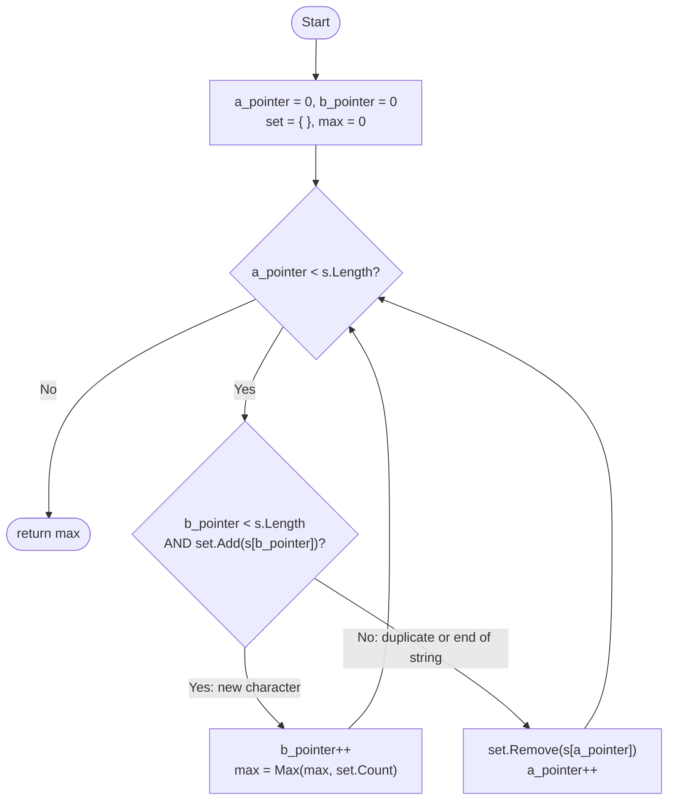

# Longest Substring Without Repeating Characters

[3. Longest Substring Without Repeating Characters](https://leetcode.com/problems/longest-substring-without-repeating-characters/description/)

Difficulty: Medium

Topic: Sliding Window

## Problem Statement

Given a string `s`, find the **length** of the **longest substring** without duplicate characters.

## What the Problem Is Asking

- A **substring** is a run of characters that sit next to each other in the string. You can't skip characters.
  For `"pwwkew"`, `"wke"` is a substring, but `"pwke"` is not. It is a **subsequence**, because it skips the second `w`.
- Of all the substrings where every character appears only once, find the longest one.
- Return its **length** (an `int`), not the substring itself.
- An empty string returns `0`.

## Examples

| Input        | Output | Explanation                          |
| ------------ | ------ | ------------------------------------ |
| `"abcabcbb"` | `3`    | The longest is `"abc"`.              |
| `"bbbbb"`    | `1`    | The longest is `"b"`.                |
| `"pwwkew"`   | `3`    | The longest is `"wke"`.              |

## Constraints

- `0 <= s.length <= 5 * 10^4`
- `s` consists of English letters, digits, symbols and spaces.

## How the Solution Works

The solution uses a **sliding window**. Think of the window as a frame laid over part of the string.
The frame only ever holds characters that are all different.

| Variable    | Meaning                                                                  |
| ----------- | ------------------------------------------------------------------------ |
| `a_pointer` | Left side of the window. The first character inside it.                  |
| `b_pointer` | Right side of the window. The next character to try to add (not inside yet). |
| `set`       | The characters inside the window, so we can check for a duplicate in O(1). |
| `max`       | The longest window seen so far. This is the answer.                      |

The window is `s[a_pointer..b_pointer]`, so its length is `b_pointer - a_pointer`, which is always the same as `set.Count`.

Each time through the loop, the code does **one** of two things:

1. **Grow (move the right side).** If there is a next character and it is not already in the window,
   add it, move `b_pointer` forward, and update `max`.
2. **Shrink (move the left side).** Otherwise, the next character is a duplicate (or we have reached the end).
   Remove the leftmost character, and move `a_pointer` forward. Keep doing this until the old copy
   of the duplicate is gone. Then growing can start again.

The loop stops when `a_pointer` reaches the end of the string. By then the window is empty,
which is why the method returns `max` and not `set.Count`.

### Flowchart



### The Window Moving

`a` = `a_pointer`, `b` = `b_pointer`. The `[ ]` brackets show what is inside the window.

**Growing.** `b` moves right while each new character is unique:

```
index:   0   1   2   3   4   5
         p   w   w   k   e   w
        [p   w]  ^
         a       b        s[b] = 'w' is already in the window, can't grow
```

**Shrinking.** `a` moves right until the old `'w'` falls out:

```
         p  [w]  w   k   e   w        removed 'p', still has a 'w'
             a   b

         p   w ][w   k   e   w        removed 'w', window is empty
                 a
                 b                    a == b, nothing inside
```

**Growing again.** Now the second `'w'` can come in:

```
         p   w  [w   k   e]  w
                 a           b        window "wke", length 3  -> max = 3
```

### Step-by-Step Trace for `"pwwkew"`

| Step | `a` | `b` | `s[b]` | Action                         | Window after | `set` after   | `max` |
| ---- | --- | --- | ------ | ------------------------------ | ------------ | ------------- | ----- |
| 1    | 0   | 0   | `p`    | Grow: add `p`                  | `p`          | {p}           | 1     |
| 2    | 0   | 1   | `w`    | Grow: add `w`                  | `pw`         | {p, w}        | 2     |
| 3    | 0   | 2   | `w`    | Duplicate: remove `p`          | `w`          | {w}           | 2     |
| 4    | 1   | 2   | `w`    | Duplicate: remove `w`          | (empty)      | { }           | 2     |
| 5    | 2   | 2   | `w`    | Grow: add `w`                  | `w`          | {w}           | 2     |
| 6    | 2   | 3   | `k`    | Grow: add `k`                  | `wk`         | {w, k}        | 2     |
| 7    | 2   | 4   | `e`    | Grow: add `e`                  | `wke`        | {w, k, e}     | **3** |
| 8    | 2   | 5   | `w`    | Duplicate: remove `w`          | `ke`         | {k, e}        | 3     |
| 9    | 3   | 5   | `w`    | Grow: add `w`                  | `kew`        | {k, e, w}     | 3     |
| 10   | 3   | 6   | end    | End of string: remove `k`      | `ew`         | {e, w}        | 3     |
| 11   | 4   | 6   | end    | End of string: remove `e`      | `w`          | {w}           | 3     |
| 12   | 5   | 6   | end    | End of string: remove `w`      | (empty)      | { }           | 3     |

`a` is now 6, which is `s.Length`, so the loop ends and the method returns **3**.

Steps 10 to 12 only empty the window. They can't change `max`, because the window only gets smaller.

### Complexity

| Measure | Cost          | Why |
| ------- | ------------- | --- |
| Time    | O(N)          | Each pointer only moves forward and moves at most N times, so the loop runs at most 2N times. Each `HashSet` add and remove is O(1). |
| Space   | O(min(N, K))  | The set holds at most the window, and the window can't hold more than the K distinct characters the string can contain. |

## Code

[Program.cs](Program.cs)
